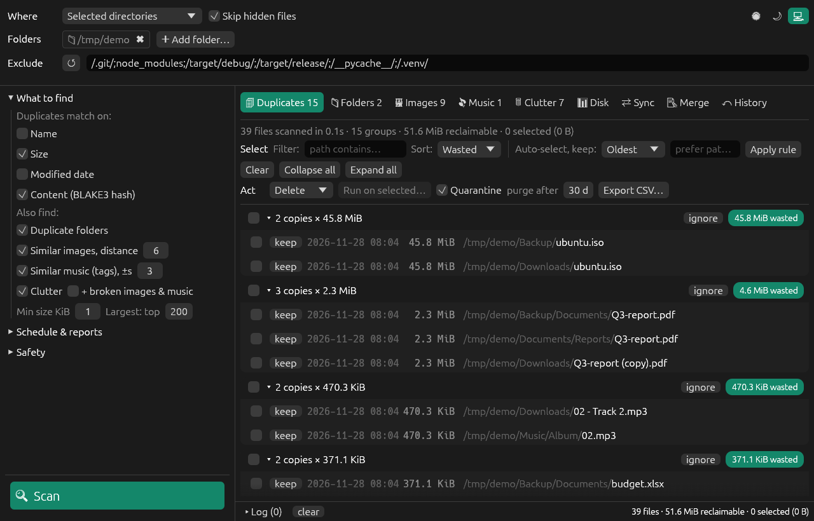
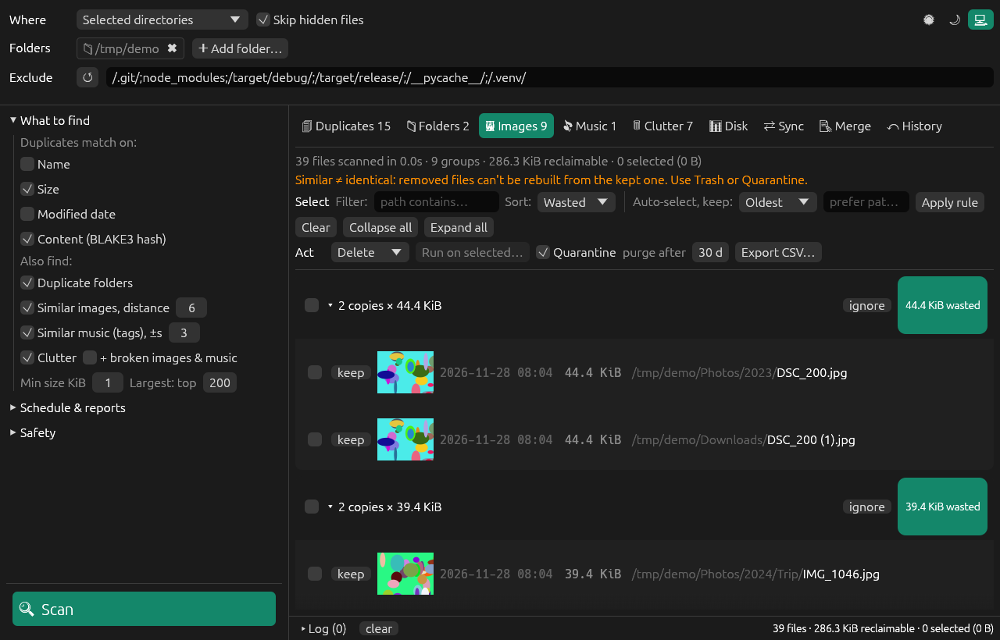
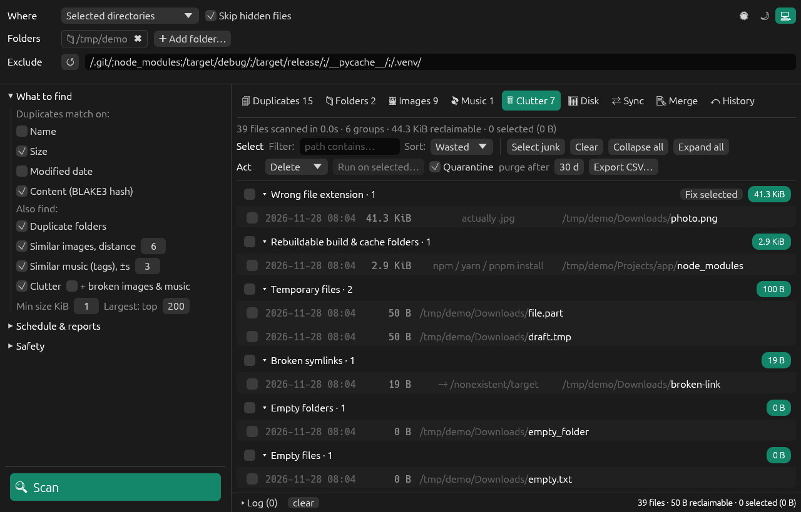
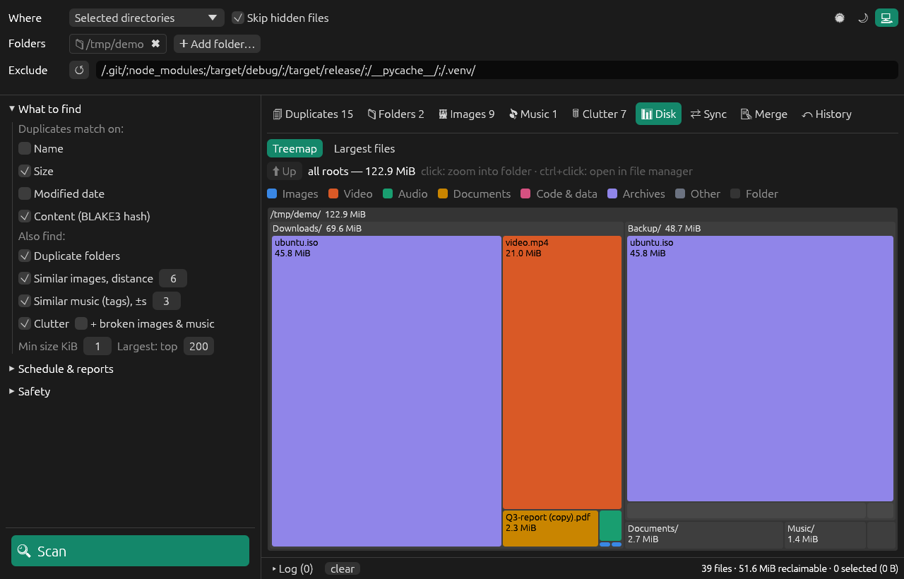
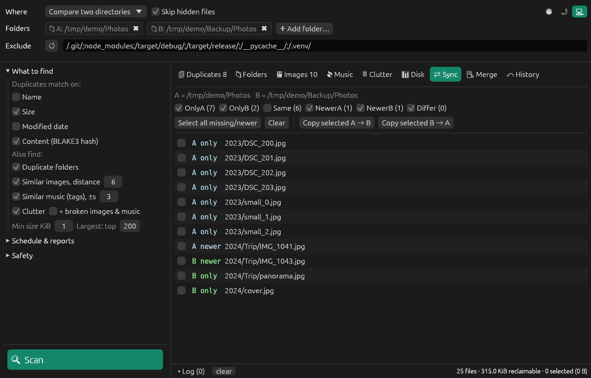

<div align="center">


# TidyTwin

**Duplicate file finder for Linux, with a GUI and a CLI.**

Find exact and similar duplicates, clean up clutter, see what fills your disk, and undo anything you do.

[](https://github.com/fagostini/tidytwin/actions/workflows/ci.yml)
[](https://github.com/fagostini/tidytwin/releases/latest)
[](LICENSE)


[Features](#features) · [Screenshots](#screenshots) · [Install](#install) · [CLI](#cli) · [Data](#data)



</div>

## Features

| | |
|---|---|
| 🧬 **Exact duplicates** | Match by any mix of name, size, modified time and content (BLAKE3 hash). |
| 📁 **Duplicate folders** | Whole directories with identical contents. |
| 🖼️ **Similar images** | Perceptual hashing finds resized or re-encoded copies. |
| 🎵 **Similar music** | Matches tracks by artist, title and duration (from tags). |
| 🧹 **Clutter** | Empty files/folders, temp files, broken symlinks, rebuildable caches, misnamed images, unportable names ([details](#clutter-detection)). |
| 📊 **Disk usage** | Treemap and largest-files list. |
| ⇄ **Sync** | Compare two directories by relative path and copy missing or newer files. |
| 🔀 **Merge** | Two-way or three-way (git-style) text merge with per-hunk conflict resolution. |
| ↩️ **Safe cleanup** | Trash, quarantine, move, hardlink, reflink or delete. Every action is journaled and can be undone from the History tab or with `tidytwin undo-last`. |
| 🛡️ **Protected folders** | Files in them are never selected or removed. OS and installed-software folders are protected by default. |
| ✅ **Keep rules** | Auto-select every copy except the oldest, newest, shortest path or first root. |
| 🙈 **Ignore groups** | Hide a duplicate group you want to keep from future scans; it comes back if its files change. |
| ⏰ **Scheduled scans** | Periodic background scans via a systemd user timer; open the reports in the GUI. |

### Clutter detection

- empty folders and empty files (marker files like `__init__.py` and dotfiles are skipped)
- temporary files (`*.tmp`, `*~`, `*.part`, `.DS_Store`, editor swap/lock files…)
- broken symlinks
- rebuildable build and cache folders: `node_modules`, Rust `target/`, Python virtualenvs and caches, `~/.cache`, anything tagged with `CACHEDIR.TAG`…
- images whose extension doesn't match their content, with one-click rename (undoable)
- file names that break on Windows, USB sticks or cloud sync (`:`, `?`, trailing dots/spaces, reserved names like `CON`, invalid UTF-8)
- optionally, images and music files that fail to open

## Screenshots

<table>
  <tr>
    <td align="center"><br><sub><b>Similar images</b> with thumbnails</sub></td>
    <td align="center"><br><sub><b>Clutter</b>: temp files, caches, wrong extensions…</sub></td>
  </tr>
  <tr>
    <td align="center"><br><sub><b>Disk</b> usage treemap</sub></td>
    <td align="center"><br><sub><b>Sync</b> two folders A ⇄ B</sub></td>
  </tr>
</table>

## Install

### Prebuilt

Download the `.deb` or the AppImage from the [latest release](https://github.com/fagostini/tidytwin/releases/latest).

```sh
sudo apt install ./tidytwin_*_amd64.deb          # Debian / Ubuntu
chmod +x TidyTwin-x86_64.AppImage && ./TidyTwin-x86_64.AppImage   # any distro
```

Running an AppImage needs `libfuse2` (`libfuse2t64` on Ubuntu 24.04+).

### Build a package

<details>
<summary>Debian / Ubuntu (<code>.deb</code>)</summary>

```sh
cargo deb
sudo apt install ./target/debian/tidytwin_0.3.0-1_amd64.deb
```

Needs [cargo-deb](https://github.com/kornelski/cargo-deb) (`cargo install cargo-deb`).

</details>

<details>
<summary>AppImage (any distro)</summary>

```sh
./packaging/build-appimage.sh
./target/TidyTwin-x86_64.AppImage
```

The script downloads appimagetool on first run.

</details>

### From source

```sh
cargo build --release
./target/release/tidytwin
```

## CLI

Run `tidytwin` with no arguments to start the GUI. Example:

```sh
tidytwin scan --exclude node_modules --format csv --out dups.csv ~/Pictures ~/Backup
```

<details>
<summary>Full usage</summary>

```
tidytwin                                    start the GUI
tidytwin scan [OPTIONS] PATH...             find duplicates, print report
tidytwin schedule hourly|daily|weekly [OPTIONS] PATH...
                                            run the scan periodically
tidytwin unschedule
tidytwin undo-last                          undo the most recent action batch
tidytwin apply REPORT.json [APPLY OPTIONS]  act on a saved report's duplicate groups
tidytwin --version

options:
  --match LIST     comma list of name,size,mtime,content   (default size,content)
  --min-size N     bytes (default 1)
  --exclude S      skip paths containing S (repeatable)
  --hidden         include dot-files
  --cross          only groups spanning 2+ roots (directory compare)
  --largest N      also list N largest files (default 50)
  --format F       json | csv                              (default json)
  --out FILE       write report to FILE instead of stdout
  --report         write report into <data dir>/reports/
  --clutter        also find empty folders/files, temp files, broken symlinks,
                   rebuildable build/cache folders, misnamed images, bad names
  --broken         with --clutter: also open every image/music file to find broken ones (slow)

apply options:
  --keep RULE      copy to keep per group: oldest|newest|shortest|first-root (default oldest)
  --prefer TEXT    keep copies whose path contains TEXT; RULE breaks ties
  --action A       trash|quarantine|hardlink|reflink (default quarantine; undo with undo-last)
  --dry-run        list what would be acted on, change nothing
```

</details>

Scheduled scans with `--report` send a desktop notification (via `notify-send`) when duplicates are found.

### GUI shortcuts

| Key | Action |
|---|---|
| <kbd>Ctrl</kbd>+<kbd>R</kbd> | Scan |
| <kbd>Esc</kbd> | Cancel scan |
| <kbd>Ctrl</kbd>+<kbd>F</kbd> | Filter |
| <kbd>Ctrl</kbd>+<kbd>Z</kbd> | Undo last batch (History tab) |

Drop folders on the window to add them.

## Data

The journal, quarantine, backups and scheduled reports live in `$XDG_DATA_HOME/tidytwin` (usually `~/.local/share/tidytwin`). Quarantined files and backups are purged after the retention period (30 days by default, configurable in settings); use **Empty quarantine…** in the History tab to clear them right away.

## License

[MIT](LICENSE)
